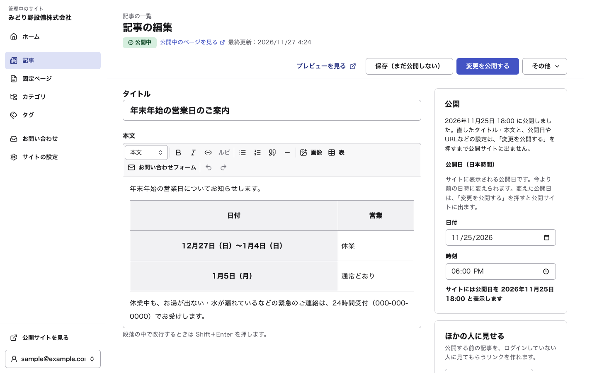

# Pagewright

中小企業・個人のWebサイト向けの、セルフホストでも速く、日本語に強いCMS。

- 管理画面は動的、公開サイトは静的に書き出すので、どのCDNやWebサーバーでも速く配信できる
- 日本語の全文検索とルビに対応（縦書きと和暦は v1 以降の予定）
- WordPress からの移行機能つき（書き出しファイル（WXR）を取り込む）

開発中です。

| 管理画面（記事の編集） | 公開サイト（コーポレートテーマ） |
| --- | --- |
|  |  |
|  |  |

## 導入する

サーバーへの導入手順は [docs/install/](docs/install/index.md)（Docker Compose で PostgreSQL・Pagewright・nginx・Caddy をまとめて動かす）。

## 開発環境で動かす

必要なものは [mise](https://mise.jdx.dev/) と Docker。`mise install` のあと `mise run dev` で、DB と Mailpit を起動して本体を動かします。
くわしくは [docs/dev/index.md](docs/dev/index.md)。

## ドキュメント

導入・運用、テーマの作り方、開発の資料は `docs/` にあります（`mise run docs:dev` でサイトとして読めます）。

## ライセンス

本体は AGPL-3.0、テーマとプラグインのSDKは MIT（予定）。
