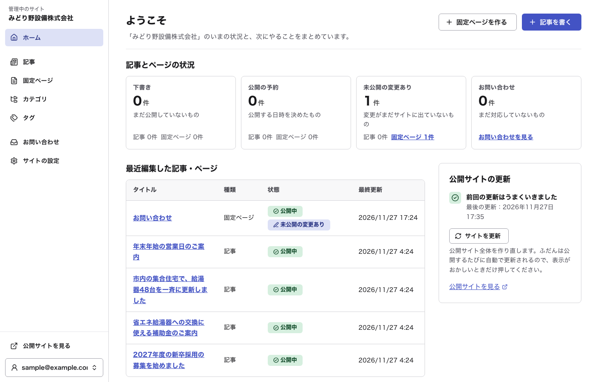
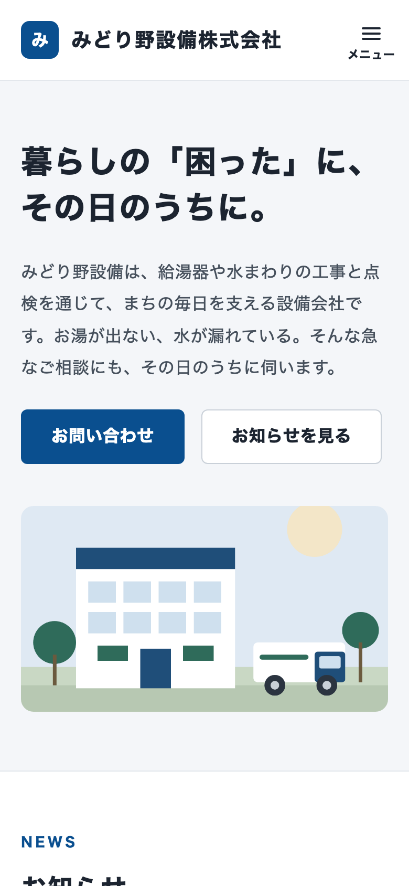

# Pagewright

中小企業・個人の会社サイト向けの、日本語に強いCMS（Webサイトを管理画面で更新するしくみ）。自分で用意したサーバーで動かします。

- **表示が速い**：公開サイトは前もって書き出したファイルなので、どのCDNやWebサーバーでも速く配信できる
- **管理画面が止まってもサイトは見える**：管理画面と公開サイトは別々に動く
- **日本語に強い**：日本語の全文検索とルビに対応（縦書きと和暦は v1 以降の予定）
- **パスワードがいらない**：ログインはメールで届くリンク
- **WordPress から移れる**：書き出しファイル（WXR）を取り込む

いまは最初の版（v0.1.0）を出したばかりの 0.x の段階です。1.0 までは、版を上げるときに互換性を壊す変更が入ることがあります（[版の付け方と互換性](docs/install/versioning.md)）。

| 管理画面（記事の編集） | 公開サイト（コーポレートテーマ） |
| --- | --- |
|  |  |
|  |  |

## ドキュメント

これからの予定は[ロードマップ](https://github.com/users/kom3da/projects/3)にあります（時期は目安）。

ドキュメントは https://kom3da.github.io/pagewright/ で読めます（中身は `docs/` にあり、手元では `mise run docs:dev` で開けます）。

- [使い方](docs/guide/index.md)：管理画面で記事やページを書いて公開する（ふだん管理画面を使う人向け）
- [導入・運用](docs/install/index.md)：サーバーに入れる、バックアップ、アップデート（サーバーの担当者向け）
- [WordPress からの移行](docs/install/wordpress.md)
- [テーマを作る](docs/themes/index.md)
- [開発](docs/dev/index.md)

## 導入する

必要なもの：

- Docker Engine 27 以降が動く Linux のサーバー1台（メモリ 2GB 以上が目安）
- ドメイン1つ（公開サイト用と管理画面用の2つの名前。例：`www.example.co.jp` と `admin.example.co.jp`）
- メール送信サービス（SMTP。ログイン用のリンクを送る）

Docker Compose で、PostgreSQL・Pagewright・nginx・Caddy（HTTPS の証明書の自動取得）をまとめて動かします。
`.env` にドメインやメールの設定を書いて `docker compose up -d` を実行し、`init` でサイトと管理者を作ります。
手順は [導入・運用](docs/install/index.md) にあります。

## 開発環境で動かす

必要なものは [mise](https://mise.jdx.dev/) と Docker。`mise install` のあと `mise run dev` で、DB と Mailpit を起動して本体を動かします。
くわしくは [docs/dev/index.md](docs/dev/index.md)。

## ライセンス

本体は AGPL-3.0、テーマとプラグインのSDKは MIT（予定）。
自社のサイトを動かすのに使うだけなら、記事や画像を公開する必要はありません。改造したものをネットワークを通してほかの人に使わせるときは、その人たちが改造後のソースコードを入手できるようにする必要があります（目安です。くわしくは [LICENSE](LICENSE)）。
