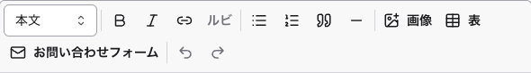
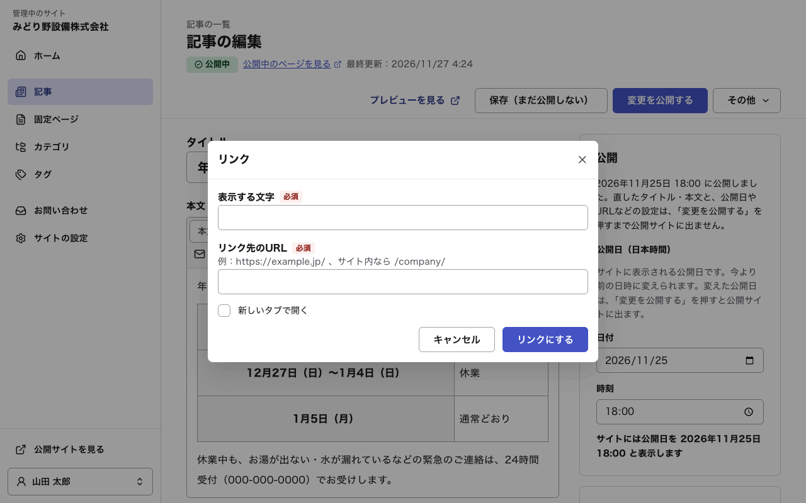
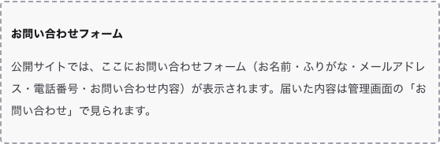

# 本文の書き方

記事と固定ページの「本文」の書き方です。
本文の上の「ツールバー」のボタンで、見出しや画像、表などを入れます。

ボタンにマウスを乗せると、名前が出ます。

| ボタン | すること |
| --- | --- |
| 段落の種類 | 「本文」「大見出し」「中見出し」「小見出し」を切り替える |
| 太字・斜体 | 選んだ文字を太字・斜体にする |
| リンク | 選んだ文字をリンクにする |
| ルビ | 選んだ文字にふりがなをつける |
| 箇条書き・番号付きリスト | 行頭に「・」や「1.」をつけて並べる |
| 引用 | ほかの文章からの引用として表示する |
| 区切り線 | 横線を入れる |
| 画像 | 画像を入れる |
| 表 | 表を入れる |
| お問い合わせフォーム | お問い合わせフォームを入れる |
| 元に戻す・やり直す | 直前の操作を取り消す・やり直す |

## 改行と段落

- **Enter**：新しい段落になります（段落のあいだに少し空きができます）。
- **Shift＋Enter**：同じ段落の中で改行します。

## 見出しをつけるには

1. 見出しにしたい行にカーソルを置きます。
2. ツールバーのいちばん左の「段落の種類」で、「大見出し」「中見出し」「小見出し」のどれかを選びます。

- 記事のタイトルが一番大きな見出しになるので、本文の見出しは「大見出し」から使います。
- 「大見出し」の下に「中見出し」、その下に「小見出し」と、順番に使います。「大見出し」を飛ばして「中見出し」から始めないでください。読み上げソフトを使う人が、ページの組み立てをつかみにくくなります。
- 見出しを本文に戻すときは、「本文」を選びます。

## リンクをつけるには

1. リンクにしたい文字を選びます。
2. ツールバーの「リンク」を押します。
3. 「リンク先のURL」を入れて、「リンクにする」を押します。

- ほかのサイトへは `https://` から、このサイトの中へは `/` から入れます。例：`https://example.jp/`、`/company/`
- 電話をかけるリンクは `tel:`、メールを書くリンクは `mailto:` から入れます。例：`tel:03-1234-5678`、`mailto:info@example.jp`
- 文字を選ばずに「リンク」を押すと、「表示する文字」の欄も出ます。
- 「新しいタブで開く」にチェックすると、リンクが新しいタブで開きます。
- リンクを直すときや外すときは、リンクの文字にカーソルを置いて「リンク」を押します。「変更する」か「リンクを外す」を押します。
- 本文に `https://` から始まる URL をそのまま書くと、自動でリンクになります。

### 電話番号・メールアドレスのリンク

スマートフォンで押すと電話がかかるリンクも作れます。「リンク先のURL」に、`tel:` に続けて電話番号を入れます。

| リンクの種類 | 「リンク先のURL」に入れるもの |
| --- | --- |
| 電話をかける | `tel:03-1234-5678` |
| メールを書く | `mailto:info@example.jp` |

電話番号には数字・ハイフン（-）・プラス（+）・かっこだけを使います。

## ルビ（ふりがな）をつけるには

1. ふりがなをつけたい文字を選びます。
2. ツールバーの「ルビ」を押します（文字を選んでいないと押せません）。
3. 「ふりがな」を入れて、「ルビをつける」を押します。

外すときは、ルビのついた文字を選んで「ルビ」を押し、「ルビを外す」を押します。

## 画像を入れるには

1. 画像を入れたい場所にカーソルを置きます。
2. ツールバーの「画像」を押します。
3. 新しい画像なら「新しい画像をアップロード」で、ファイルと「画像の説明（代替テキスト）」を入れて「アップロードして入れる」を押します。前にアップロードした画像なら、「アップロード済みの画像から選ぶ」で画像を押し、「この画像を入れる」を押します。

くわしくは「[画像](./images.md)」を見てください。

## 表を入れるには

1. 表を入れたい場所にカーソルを置きます。
2. ツールバーの「表」を押します。3行3列の表が入ります。いちばん上の行は見出しの行です。
3. マス目をクリックして、文字を入れます。Tab キーで次のマスに移れます。

表の中にカーソルがあると、ツールバーに次のボタンが出ます。

- 「行を追加」「列を追加」：カーソルのある行の下・列の右に足します
- 「行を削除」「列を削除」：カーソルのある行・列を消します
- 「表を削除」：表をまるごと消します

表はスマートフォンでは横に長くなりがちです。列は少なめ（3〜4列まで）にすると読みやすくなります。

## お問い合わせフォームを入れるには

1. フォームを置きたい場所にカーソルを置きます（ふつうは「お問い合わせ」の固定ページ）。
2. ツールバーの「お問い合わせフォーム」を押します。

- 編集画面では、点線の枠だけが出ます。公開サイトでは、ここに「お名前」「ふりがな」「メールアドレス」「電話番号」「お問い合わせ内容」の欄と、「個人情報の取り扱いに同意します」のチェックが出ます。
- 欄の種類は変えられません。
- 届いた内容は、管理画面の「[お問い合わせ](./inquiries.md)」で見られます。
- 「個人情報の取り扱い」のページへのリンクを出すには、管理者が「[サイトの設定](./settings.md#トップページと案内)」でそのページを選んでおきます。
- フォームを消すときは、枠を押して選び、Delete キー（Mac は delete キー）を押します。

## 移行した内容のブロック

WordPress などから移行した記事には、編集画面で次のような枠が出ることがあります。

- **「埋め込み（YouTube など）：URL」**：動画などの埋め込みです。
- **「カスタムHTML（移行した内容です。この画面では編集できません）」**：元のサイトの HTML をそのまま残したものです。

どちらも、この画面では中身を直せません。カスタムHTMLを消したり変えたりできるのは管理者だけです。

## スマートフォンで書く

スマートフォンのツールバーには、「段落の種類」「太字」「リンク」「画像」だけが並びます。
ほかのボタンは「ほか」を押すと出ます。
