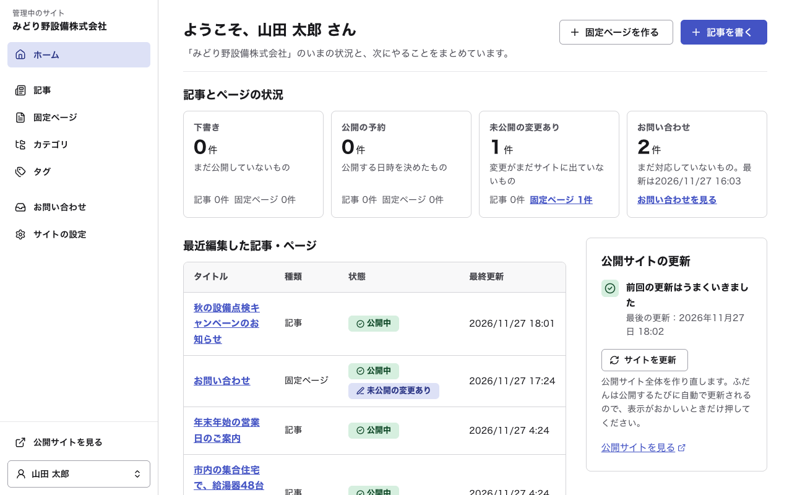
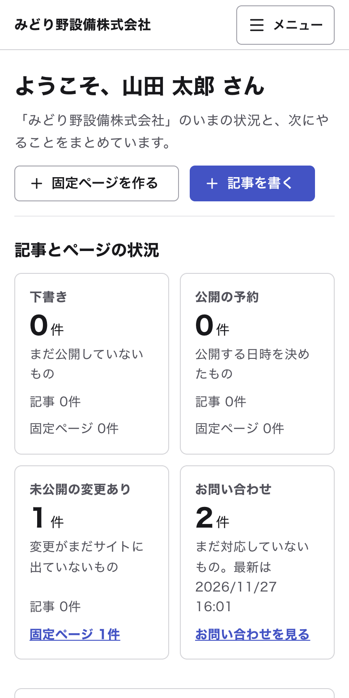

# ホーム

ログインすると、最初に「ホーム」が出ます。
サイトのいまの状況と、次にやることがまとまっています。

## 上のボタン

- **「記事を書く」**：新しい記事を書きはじめます（[記事を書く・公開する](./posts.md)）
- **「固定ページを作る」**：新しい固定ページを作ります（[固定ページと親子](./pages.md)）

## はじめに

まだ何も公開していないサイトでは、「はじめに」の手順が出ます。

1. サイトの名前・ロゴ・色を決める（管理者だけ）
2. 会社概要などの固定ページを作る
3. 最初の記事を書く

終わった手順には「済み」と付きます。記事かページを1つ公開すると、「はじめに」は出なくなります。

## 記事とページの状況

気にかけておきたいものの件数です。下の「記事 ○件」「固定ページ ○件」を押すと、その一覧が出ます。

| 枠 | 意味 |
| --- | --- |
| 下書き | まだ公開していないもの |
| 公開の予約 | 公開する日時を決めたもの。次に公開される日時も出ます |
| 未公開の変更あり | 公開したあとに直したが、その変更がまだ公開サイトに出ていないもの |
| お問い合わせ | まだ対応していないお問い合わせ（管理者だけ）。「お問い合わせを見る」で一覧へ |

「未公開の変更あり」が残っていたら、直した内容を公開し忘れていないか確かめてください。

## 最近編集した記事・ページ

最近保存した記事と固定ページが、新しい順に5件出ます。タイトルを押すと、編集画面が開きます。

## 公開サイトの更新

公開サイトを最後に作り直したときの結果です。

- **「前回の更新はうまくいきました」**：問題ありません。
- **「前回の更新がうまくいきませんでした」**：「サイトを更新」を押してください。くわしくは「[サイトを更新する](./site-update.md)」。
- **「気をつけること（○件）」**：公開サイトにうまく出せなかったものがあります。書いてある内容を確かめてください。

「公開サイトを見る」を押すと、公開サイトが新しいタブで開きます。

## スマートフォンでは

スマートフォンでは、枠が縦に1列に並びます。「公開サイトの更新」は「最近編集した記事・ページ」より上に出ます。

{width=320}
