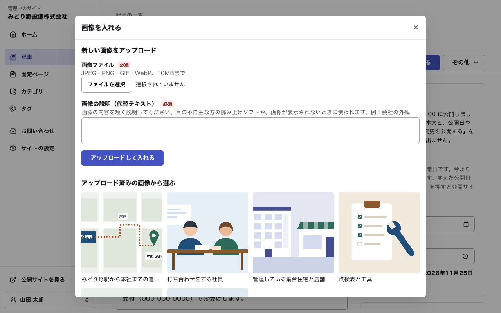

# 画像

記事や固定ページに画像を入れる方法と、アップロードした画像の扱いです。
画像は、本文のツールバーの「画像」から入れます。画像だけをまとめて管理する画面は、今はありません。

## 画像を入れるには

1. 本文の、画像を入れたい場所にカーソルを置きます。
2. ツールバーの「画像」を押します。「画像を入れる」のダイアログが開きます。

### 新しい画像を入れる

1. 「新しい画像をアップロード」の「画像ファイル」で、ファイルを選びます。
2. 「画像の説明（代替テキスト）」を入れます。
3. 「アップロードして入れる」を押します。

### 前にアップロードした画像を入れる

1. 「アップロード済みの画像から選ぶ」で、画像を押します。
2. 「画像の説明（代替テキスト）」を確かめます（前に入れた説明が入っています）。
3. 「この画像を入れる」を押します。

## 使える画像

- 形式：JPEG・PNG・GIF・WebP
- 大きさ：1枚 **10MB まで**

スマートフォンで撮った写真は、そのままでも入れられます。
10MB を超えるときは、写真アプリなどで小さくしてからアップロードしてください。

## 画像の説明（代替テキスト）

画像には、必ず「画像の説明（代替テキスト）」を入れます。
目の不自由な方の読み上げソフトや、画像が表示されないときに使われます。

書き方のこつ：

- 画像を見られない人に、電話で伝えるつもりで、短く書きます。例：「会社の外観」「点検表と工具」
- 「画像」「写真」という言葉は入れなくてかまいません。
- 地図や図のように、画像の中に大事な情報があるときは、その中身を書きます。例：「みどり野駅から本社までの道順の図。駅の東口を出て、北へ徒歩5分」
- 500文字まで入れられますが、長い説明は本文に書くほうが読みやすくなります。

本文に入れたあとの画像の説明は、今は直せません。直したいときは、本文から画像を消して、入れ直してください。

## 画像を削除するには

1. 本文のツールバーの「画像」を押します。
2. 「アップロード済みの画像から選ぶ」で、削除する画像を押します。
3. 「この画像を削除」を押し、確認が出たら「削除する」を押します。

- 記事や固定ページで使っている画像は、削除できません。先に本文から外して保存してください。公開中の記事やページなら、外したあと「変更を公開する」まで押します（公開サイトに出ている内容や、予約している内容で使っていると、削除できません）。
- サイトのロゴに使っている画像も削除できません。
- 削除した画像は元に戻せません。

## 画像の容量の上限

サーバーによっては、1つのサイトに保存できる画像の合計に上限があります（上限を決めるのはサーバーの管理者です）。

上限を超えると、アップロードのときに「画像を保存できる容量（○MB）がいっぱいのため、この画像を追加できません」と出ます。
使っていない古い画像を削除すると、その分だけまた追加できます。
容量を増やしたいときは、サーバーの管理者（サイトを作った会社や担当者）に相談してください。
