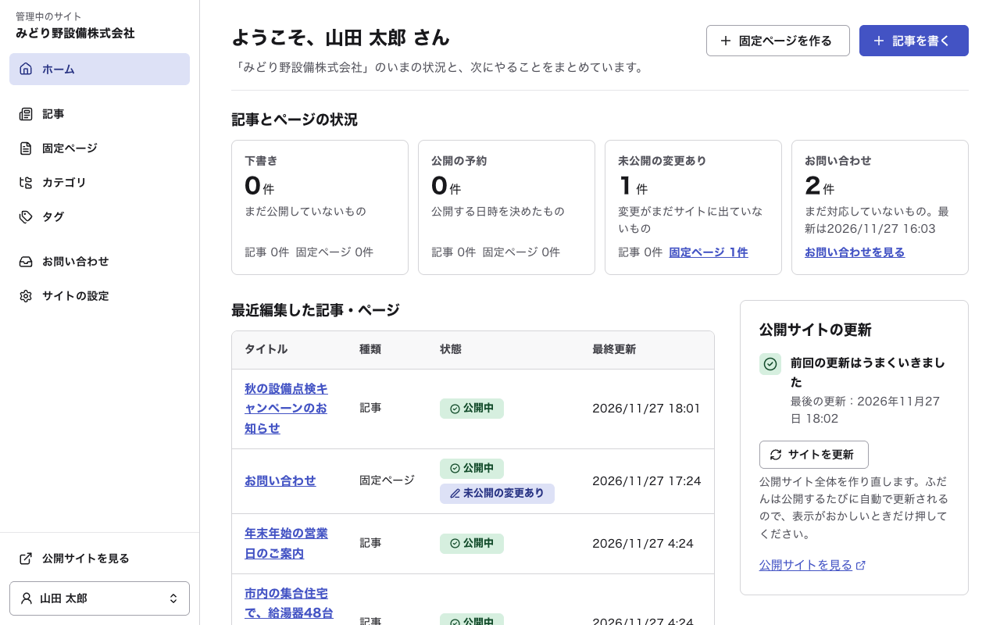
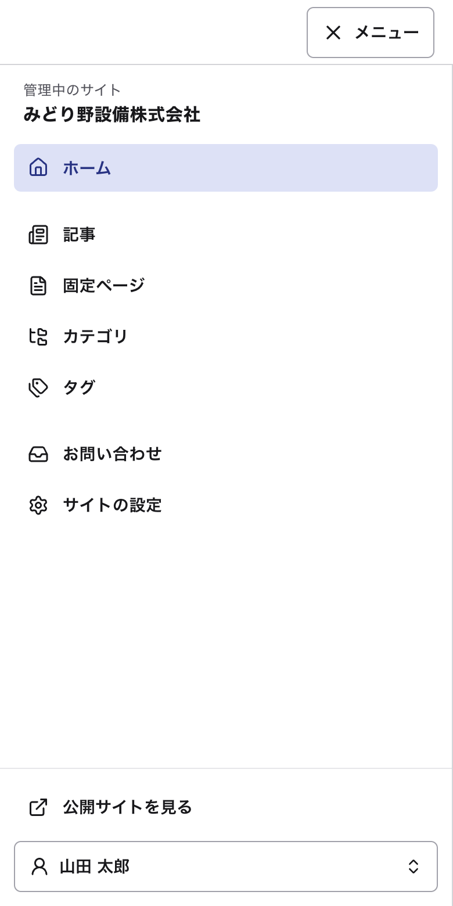

# はじめに

Pagewright（ページライト）の管理画面の使い方です。
会社のお知らせを書く人、ページを直す人、お問い合わせに答える人など、ふだん管理画面を使う人に向けて書いています。

サーバーへの入れ方は「[導入・運用](../install/)」を見てください。

## 管理画面と公開サイト

Pagewright には、2つの画面があります。

| | 何をするところか | 誰が見るか |
| --- | --- | --- |
| **管理画面** | 記事やページを書く、公開する、設定を変える | ログインした人だけ |
| **公開サイト** | 会社のWebサイト | 誰でも |

管理画面で書いたものは、「公開する」を押すまで公開サイトには出ません。
公開すると、公開サイトが自動で作り直されます。反映まで少し時間がかかることがあります。

## 画面の見方

左側がメニューです。

- **いちばん上**：いま管理しているサイトの名前（「管理中のサイト」）
- **ホーム**：いまの状況と、次にやること
- **記事**・**固定ページ**・**カテゴリ**・**タグ**：サイトの中身を作る
- **お問い合わせ**・**メンバー**・**サイトの設定**：管理者だけに出ます
- **いちばん下**：「公開サイトを見る」と、自分の名前（アカウントのメニュー）

## 記事と固定ページのちがい

| | 記事 | 固定ページ |
| --- | --- | --- |
| 向いているもの | お知らせ、ブログ、施工事例など、日付のあるもの | 会社概要、アクセス、採用情報など、いつも置いておくもの |
| 並び方 | 新しい順 | 親ページの下に子ページ |
| 分け方 | カテゴリとタグ | 親ページ |
| URL の例 | `/posts/year-end-2026/` | `/company/history/` |

書き方と公開のしかたは、どちらも同じです。

## 管理者と編集者

使う人には「管理者」と「編集者」の2つの役割があります。

| できること | 管理者 | 編集者 |
| --- | --- | --- |
| 記事・固定ページを書く、公開する | ○ | ○ |
| カテゴリ・タグ・画像を管理する | ○ | ○ |
| サイトを更新する | ○ | ○ |
| お問い合わせを見る | ○ | × |
| サイトの設定を変える | ○ | × |
| メンバーを招待する、役割を変える、外す | ○ | × |

編集者には、メニューに「お問い合わせ」「メンバー」「サイトの設定」が出ません。
お問い合わせを見る係の人は、管理者にしてもらいます。
使う人を増やすときは、管理者が「[メンバーと招待](./members.md)」から招待します。

## だれに聞くか

このページでは、相談する相手を次の2つの呼び方で書いています。

| 呼び方 | どんな人か | 聞くこと |
| --- | --- | --- |
| **管理者** | 管理画面で「管理者」の役割を持っている人（社内の人） | サイトの設定、お問い合わせ、メンバーの追加、自分のメールアドレスが登録されているか |
| **サーバーの担当者** | Pagewright をサーバーに入れた人や会社 | 管理画面のアドレス、公開サイトのアドレス（ドメイン）、画像の容量、何度やってもうまくいかないとき |

メンバーの追加は「[メンバーと招待](./members.md)」で説明します。

## スマートフォンで使う

スマートフォンでも使えます。
画面の上の「メニュー」を押すと、左からメニューが出ます。

{width=320}

記事の編集画面では、「保存」「公開する」などのボタンが画面の下に並びます。
くわしくは「[記事を書く・公開する](./posts.md#スマートフォンで書く)」を見てください。

## 次に読むページ

1. [ログインとログアウト](./login.md)
2. [ホーム](./home.md)
3. [はじめての記事（画像つきのお知らせを出す）](./first-post.md)
4. [記事を書く・公開する](./posts.md)
