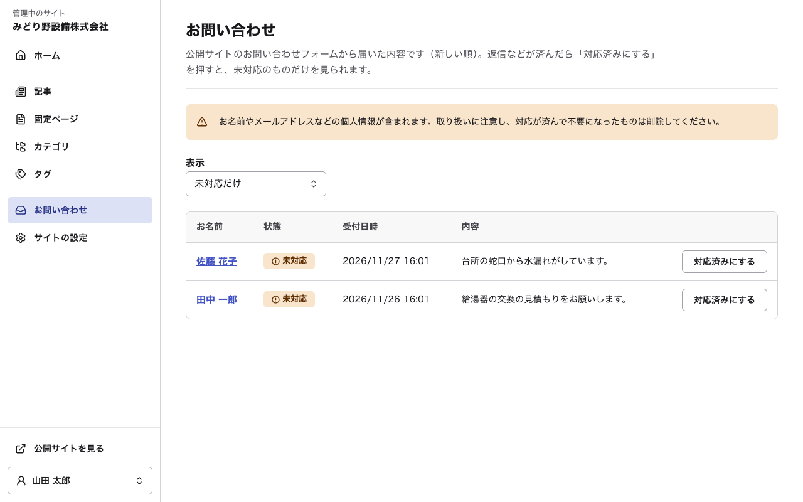
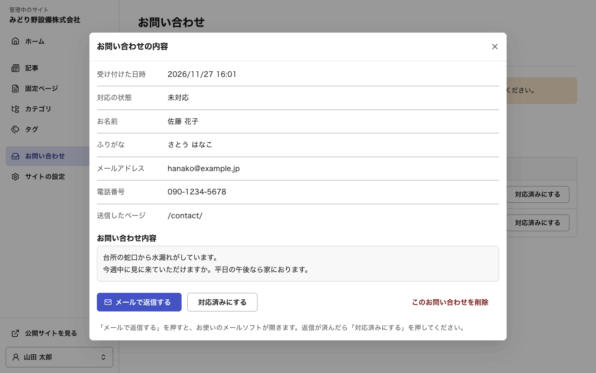

# お問い合わせ

公開サイトのお問い合わせフォームから届いた内容を見て、対応を記録します。
**管理者だけ** が使えます。

お問い合わせを受け付けるには、固定ページの本文にお問い合わせフォームを入れて公開します（「[お問い合わせフォームを入れるには](./editor.md#お問い合わせフォームを入れるには)」）。

## お問い合わせが届いたら

- 「お問い合わせの送り先メールアドレス」（[サイトの設定](./settings.md#お問い合わせの送り先)）にメールが届きます。空欄なら、管理者全員に届きます。
- ホームの「お問い合わせ」の枠に、まだ対応していない件数が出ます。
- お問い合わせした人には、「【サイトの名前】お問い合わせを受け付けました」という件名の自動返信のメールが届きます。中身は「（サイトの名前） のお問い合わせフォームから送信された内容を受け付けました。担当者より折り返しご連絡いたします。」という決まった文と、送信専用のアドレスから送っていることの断り書きで、入力された内容は書いてありません（同じメールアドレスへは1日3通まで）。

通知のメールの差出人は、サイトのメールの送信用のアドレスです。通知のメールにそのまま「返信」すると、お問い合わせした人ではなく、その送信用のアドレスあてになります。返信は、通知のメールや管理画面に出ている、お問い合わせした人のメールアドレスあてに送ってください。

## お問い合わせを見るには

メニューの「お問い合わせ」を押します。新しい順に並びます。

はじめは、まだ対応していないもの（「未対応」）だけが出ます。
「表示」で「対応済みだけ」「すべて」に切り替えられます。

お名前を押すと、内容がすべて出ます。

## 返信して、対応済みにするには

1. お名前を押して、内容を開きます。
2. 「メールで返信する」を押します。お使いのメールソフトが開き、件名に「【サイトの名前】お問い合わせありがとうございます」が入ります。
3. 返信を送ります。

   メールソフトが開かないとき（ブラウザでメールを読んでいるときなど）は、内容に出ているメールアドレスをコピーして、ふだん使っているメールから送ります。
4. 管理画面に戻り、「対応済みにする」を押します。

対応済みにすると、「未対応だけ」の表示から消えます。誰がいつ対応済みにしたかは、内容の「対応の状態」に出ます。
まちがえたときは、「表示」を「対応済みだけ」にして、「未対応に戻す」を押します。

電話で答えたときなど、メールで返信しないときも、対応が済んだら「対応済みにする」を押してください。

## 個人情報の扱い

お問い合わせには、お名前やメールアドレスなどの個人情報が含まれます。

- 管理画面を使うパソコンやスマートフォンを、ほかの人に使わせないでください。
- 対応が済んで不要になったお問い合わせは、内容を開いて「このお問い合わせを削除」を押し、削除してください。削除したものは元に戻せません。

## 次に読むページ

- [サイトの設定](./settings.md#お問い合わせの送り先)：通知の送り先を決める
- [本文の書き方](./editor.md#お問い合わせフォームを入れるには)：フォームを入れる
