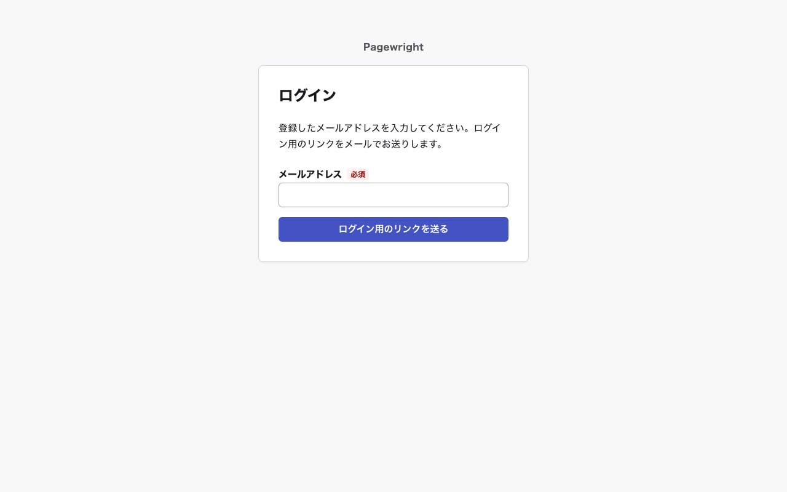
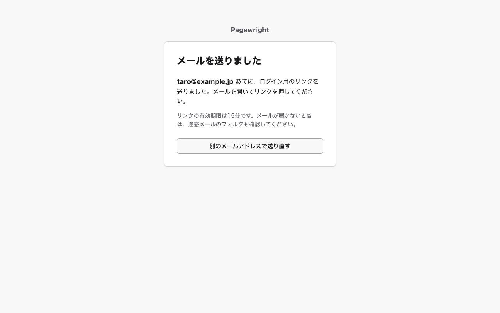
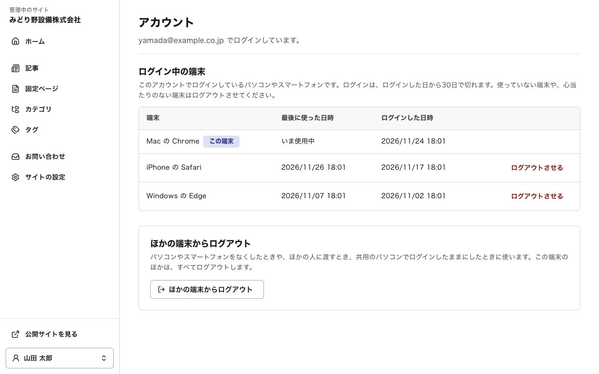

# ログインとログアウト

Pagewright にはパスワードがありません。
登録したメールアドレスに届く「ログイン用のリンク」でログインします。

## はじめに受け取るもの

ログインには、次の2つが要ります。どちらも、サーバーの担当者（Pagewright をサーバーに入れた人や会社）から受け取ります。

- **管理画面のアドレス**（例：`https://admin.example.co.jp/`）。ブラウザのブックマーク（お気に入り）に入れておくと便利です
- **登録したメールアドレス**。このアドレスにログイン用のメールが届きます

初めて使うときは、管理者から届く招待のメールのリンクを開いて「参加する」を押します（「[招待されたときは](./members.md#招待されたときは)」）。そのままログインできます。

## ログインするには

1. 管理画面のアドレス（例：`https://admin.example.co.jp/`）を開きます。
2. 「メールアドレス」に、登録したメールアドレスを入れて、「ログイン用のリンクを送る」を押します。

   

3. 「メールを送りました」と出たら、メールを開きます。件名は「Pagewright ログイン用のリンク」です。差出人の名前（例：「ウェブサイト管理」）は、サーバーの担当者が決めています。

   

4. メールの中のリンクを開くと、「ログイン」ボタンだけの画面が出ます。「ログイン」を押します。

   

5. ホームが出たら、ログインできています。

覚えておくこと：

- ログイン用のリンクの有効期限は **15分** です。**1回だけ** 使えます。
- メールを開いたパソコンやスマートフォンでログインします。パソコンでログインしたいときは、パソコンでメールを開いてください。
- ログインは、ログインした日から **30日** で切れます。切れたら、もう一度リンクを送ってください。
- 管理するサイトが2つ以上あるときは、ログインのあとに「サイトを選ぶ」画面が出ます。あとからメニューのいちばん上（サイトの名前）を押して切り替えられます。

メールが届かないときは「[困ったとき](./troubleshooting.md#ログインのメールが届かない)」を見てください。

## ログアウトするには

1. メニューのいちばん下の、自分の名前を押します。
2. 「ログアウト」を押します。

共用のパソコンで使ったときは、終わったら必ずログアウトしてください。

## 名前を変えるには

メニューのいちばん下や、「メンバー」の一覧に出る自分の名前を変えられます。

1. メニューのいちばん下の、自分の名前を押します。
2. 「名前とログイン中の端末」を押します。
3. 「名前」の「あなたの名前」を直して、「名前を保存する」を押します。

- 名前は50文字までです。空にすると、名前の代わりにメールアドレスが出ます。
- 2つ以上のサイトのメンバーのときは、どのサイトでも同じ名前になります。

## ログイン中の端末を確かめるには

自分のアカウントでログインしているパソコンやスマートフォンの一覧を見られます。

1. メニューのいちばん下の、自分の名前を押します。
2. 「名前とログイン中の端末」を押します。「アカウント」の画面の「ログイン中の端末」に一覧が出ます。

一覧には「端末」「最後に使った日時」「ログインした日時」が出ます。いま使っている端末には「この端末」と付きます。

### 1台だけログアウトさせる

使っていない端末や、心当たりのない端末の行で「ログアウトさせる」を押します。
確認が出たら、もう一度「ログアウトさせる」を押します。

### ほかの端末からまとめてログアウトする

スマートフォンをなくしたときや、共用のパソコンでログインしたままにしたときに使います。

1. 「ほかの端末からログアウト」を押します。
2. 確認が出たら「ログアウトする」を押します。

いま使っている端末はログインしたままです。ほかの端末はすべてログアウトします。

## 名前やメールアドレスを変えるには

メニューのいちばん下に出る自分の名前（表示名）を変える方法は、「メンバーと招待」のページ（準備中）で説明します。
ログインに使うメールアドレスは、いまは管理画面から変えられません。

## 次に読むページ

- [ホーム](./home.md)
- [はじめての記事（画像つきのお知らせを出す）](./first-post.md)
