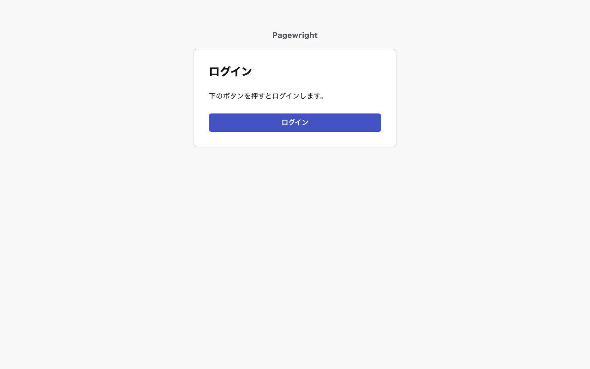
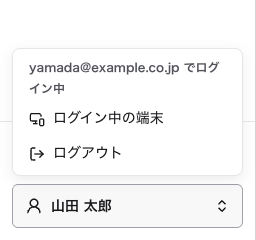

# ログインとログアウト

Pagewright にはパスワードがありません。
登録したメールアドレスに届く「ログイン用のリンク」でログインします。

## ログインするには

1. 管理画面のアドレス（例：`https://admin.example.co.jp/admin/`）を開きます。
2. 「メールアドレス」に、登録したメールアドレスを入れて、「ログイン用のリンクを送る」を押します。

   

3. 「メールを送りました」と出たら、メールを開きます。件名は「Pagewright ログイン用のリンク」です。

   

4. メールの中のリンクを開くと、「ログイン」ボタンだけの画面が出ます。「ログイン」を押します。

   

5. ホームが出たら、ログインできています。

覚えておくこと：

- ログイン用のリンクの有効期限は **15分** です。**1回だけ** 使えます。
- メールを開いたパソコンやスマートフォンでログインします。パソコンでログインしたいときは、パソコンでメールを開いてください。
- ログインは、ログインした日から **30日** で切れます。切れたら、もう一度リンクを送ってください。
- 管理するサイトが2つ以上あるときは、ログインのあとに「サイトを選ぶ」画面が出ます。あとからメニューのいちばん上（サイトの名前）を押して切り替えられます。

メールが届かないときは「[困ったとき](./troubleshooting.md#ログインのメールが届かない)」を見てください。

## ログアウトするには

1. メニューのいちばん下の、自分の名前を押します。
2. 「ログアウト」を押します。

共用のパソコンで使ったときは、終わったら必ずログアウトしてください。

## ログイン中の端末を確かめるには

自分のアカウントでログインしているパソコンやスマートフォンの一覧を見られます。

1. メニューのいちばん下の、自分の名前を押します。
2. 「ログイン中の端末」を押します。

一覧には「端末」「最後に使った日時」「ログインした日時」が出ます。いま使っている端末には「この端末」と付きます。

### 1台だけログアウトさせる

使っていない端末や、心当たりのない端末の行で「ログアウトさせる」を押します。
確認が出たら、もう一度「ログアウトさせる」を押します。

### ほかの端末からまとめてログアウトする

スマートフォンをなくしたときや、共用のパソコンでログインしたままにしたときに使います。

1. 「ほかの端末からログアウト」を押します。
2. 確認が出たら「ログアウトする」を押します。

いま使っている端末はログインしたままです。ほかの端末はすべてログアウトします。
