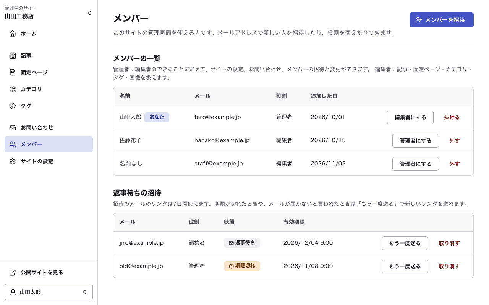
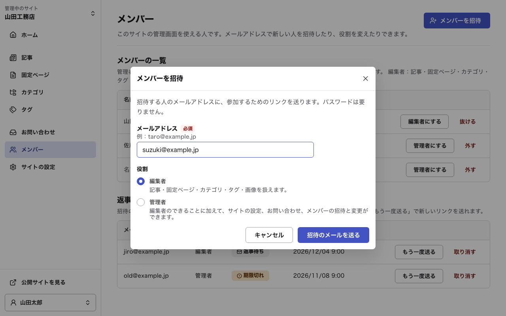
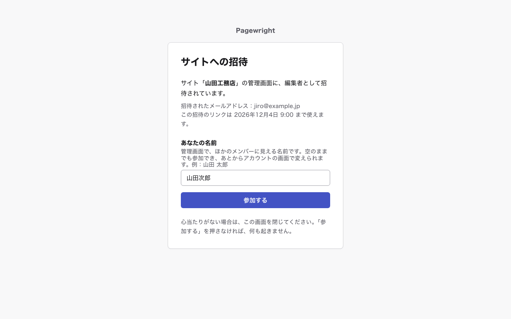

# メンバーと招待

管理画面を使える人（メンバー）を増やしたり、役割を変えたり、外したりします。
**管理者だけ** が使えます。編集者には、メニューに「メンバー」が出ません。

## 新しい人を招待するには

1. メニューの「メンバー」を押します。
2. 右上の「メンバーを招待」を押します。
3. 招待する人の **メールアドレス** を入れ、**役割**（編集者か管理者）を選びます。
4. 「招待のメールを送る」を押します。

招待した人には、「「（サイトの名前）」の管理画面に招待されました」という件名のメールが届きます。
その人がメールのリンクを開いて「参加する」を押すと、メンバーになります。
それまでは、画面の下の「返事待ちの招待」に出ます。

覚えておくこと：

- 招待のリンクは **7日間** 使えます。**1回だけ** 使えます。
- 招待された人にパスワードは要りません。Pagewright を初めて使う人も、リンクを開いて「参加する」を押すだけで使い始められます。
- 同じメールアドレスをもう一度招待すると、前の招待は取り消され、新しい役割で招待し直します（前のメールのリンクは使えなくなります）。
- すでにメンバーになっている人は招待できません。役割を変えたいときは、下の「役割を変えるには」を見てください。
- 1日に送れる招待のメールの数には上限があります（同じメールアドレスへは1日5通まで）。

### どちらの役割にするか

| できること | 管理者 | 編集者 |
| --- | --- | --- |
| 記事・固定ページを書く、公開する | ○ | ○ |
| カテゴリ・タグ・画像を管理する | ○ | ○ |
| お問い合わせを見る | ○ | × |
| サイトの設定を変える | ○ | × |
| メンバーを招待する、役割を変える、外す | ○ | × |

迷ったら **編集者** にしておき、必要になったら管理者に変えるのがおすすめです。

## 招待のメールが届かないと言われたら

1. 迷惑メールのフォルダを見てもらってください。
2. 「返事待ちの招待」のメールアドレスにまちがいがないか確かめます。まちがっていたら「取り消す」を押し、正しいアドレスで招待し直します。
3. 合っていれば「もう一度送る」を押します。新しいリンクを送り、有効期限も7日後に延びます（前に送ったリンクは使えなくなります）。

7日が過ぎて期限が切れた招待には「期限切れ」と出ます。「もう一度送る」で送り直せます。
期限切れの招待は、30日たつと一覧から自動で消えます。

## 招待を取り消すには

「返事待ちの招待」で、その行の「取り消す」を押します。確認が出たら、もう一度「取り消す」を押します。
取り消した招待のリンクは使えなくなります。

## 役割を変えるには

「メンバーの一覧」で、その人の行の「管理者にする」か「編集者にする」を押します。すぐに変わります。

- 自分を編集者にするときは、確認が出ます。編集者になると、この画面は使えなくなります。管理者に戻るには、ほかの管理者に頼んでください。
- サイトには、いつも **1人以上の管理者** が必要です。管理者が自分1人のときは、自分を編集者にできません。先にほかの人を管理者にしてください。

## メンバーを外すには

担当を外れた人や、退職した人は、サイトから外します。

1. 「メンバーの一覧」で、その人の行の「外す」を押します。
2. 確認が出たら、もう一度「外す」を押します。

- 外した人は、ログイン中でも、すぐにこのサイトの管理画面を使えなくなります。
- **その人が書いた記事・固定ページや、入れた画像は消えません。** サイトにそのまま残り、ほかのメンバーが続けて直せます。
- その人がほかのサイトのメンバーでもあるときは、そちらはそのまま使えます。
- もう一度招待すれば、また参加できます。
- 最後の管理者は外せません。

自分がサイトから抜けるときは、自分の行の「抜ける」を押します。抜けたあとに戻るには、ほかの管理者にもう一度招待してもらいます。

## 招待されたときは

招待のメールのリンクを開くと、「サイトへの招待」の画面が出ます。

1. どのサイトに、どの役割で招待されたかを確かめます。
2. 初めて Pagewright を使うときは、「あなたの名前」を入れます（空のままでもかまいません。あとから変えられます）。
3. 「参加する」を押します。

そのままログインして、招待されたサイトのホームが出ます。次からは、ふつうの[ログイン](./login.md)で入れます。

- リンクを開いただけでは参加しません。「参加する」を押したときに参加します。
- 別のメールアドレスでログインしているときは、「いまは別のメールアドレスでログインしています」と出ます。「ログアウトする」を押してから、「参加する」を押してください。
- 心当たりのない招待なら、何もせずに画面を閉じてください。
