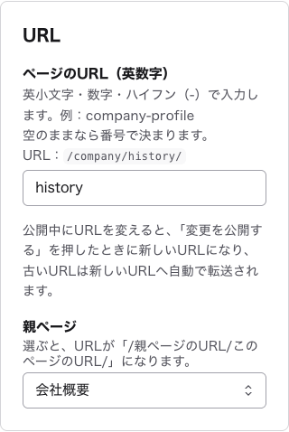
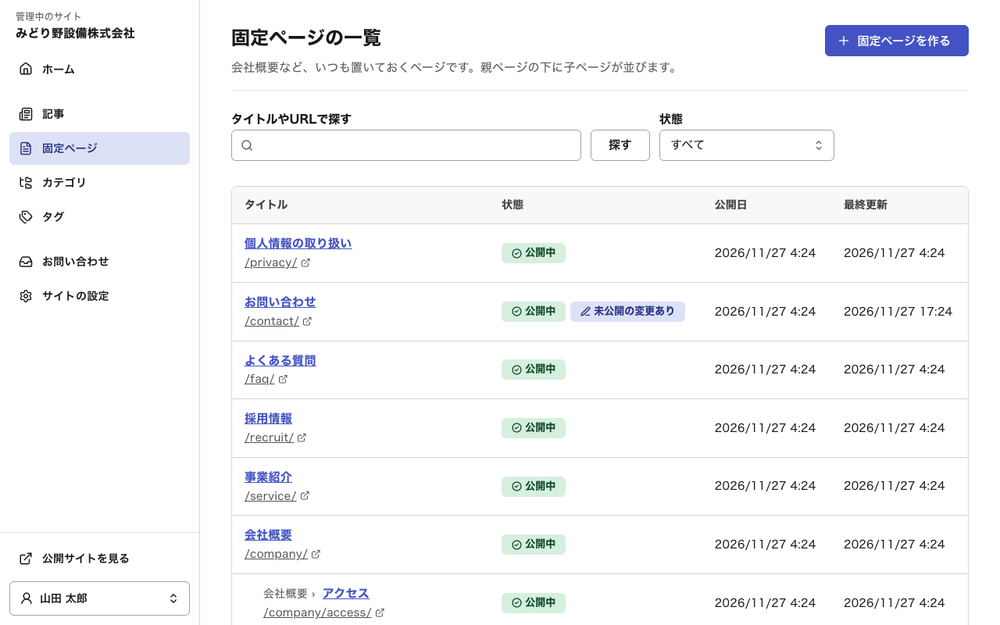

# 固定ページと親子

会社概要、アクセス、採用情報など、いつも置いておくページは「固定ページ」で作ります。
書き方と公開のしかたは記事と同じです（「[記事を書く・公開する](./posts.md)」）。

## 固定ページを作るには

1. メニューの「固定ページ」を押し、「固定ページを作る」を押します。
2. 「固定ページの編集」の画面で、タイトルと本文を書きます。
3. 右の「URL」の枠で、「ページのURL（英数字）」を決めます。例：`company`
4. 「公開する」を押します。

固定ページには、カテゴリとタグはありません。

## 親ページと子ページ

固定ページは、親子にまとめられます。たとえば「会社概要」の下に「沿革」「アクセス」を置くと、次のような URL になります。

| ページ | URL |
| --- | --- |
| 会社概要 | `/company/` |
| 沿革（親：会社概要） | `/company/history/` |
| アクセス（親：会社概要） | `/company/access/` |

### 親ページを決めるには

1. 子にしたいページを開きます。
2. 右の「URL」の枠の「親ページ」で、親にするページを選びます。
3. 欄の上の「URL：」に、新しい URL が出るので確かめます。
4. 保存します（公開中なら「変更を公開する」）。

- いちばん上の階層に戻すときは、「なし（いちばん上の階層）」を選びます。
- 自分自身や、自分の下にあるページは、親に選べません。
- 公開中のページの URL を変えると、古い URL は新しい URL へ自動で転送されます。

## 固定ページの一覧

「固定ページの一覧」では、親ページの下に子ページが字下げして並びます。子ページのタイトルの前には「会社概要 ›」のように親ページの名前が出ます。
公開中のページには、タイトルの下に公開サイトの URL が出ます。押すと、公開中のページが新しいタブで開きます。

探し方は記事と同じです（「[記事を探すには](./posts.md#記事を探すには)」）。

## トップページとメニュー

- **トップページに固定ページを載せる**：「サイトの設定」の「トップに載せる固定ページ」で選びます。
- **公開サイトのメニューに入れる**：「サイトの設定」の「メニュー」で追加します。

どちらも管理者が設定します。くわしくは「[サイトの設定](./settings.md)」を見てください。
