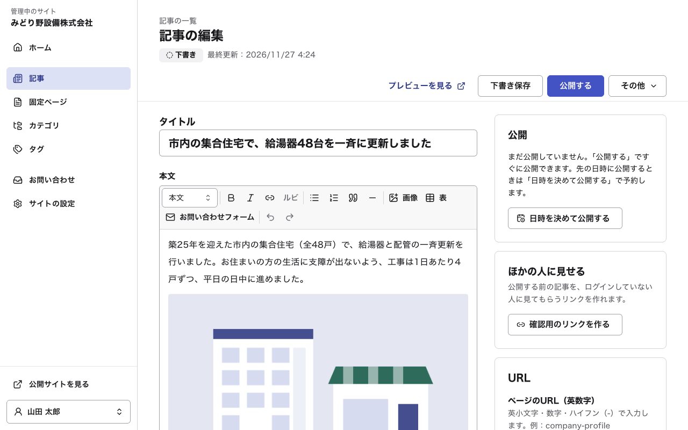
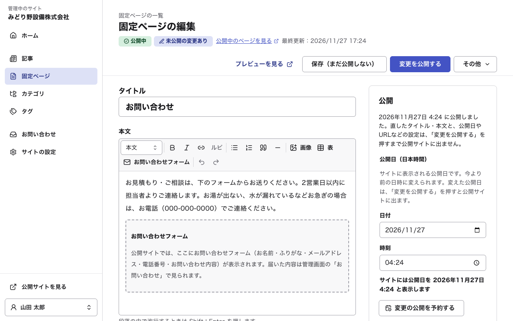
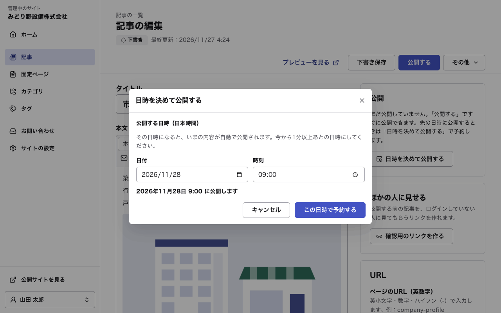
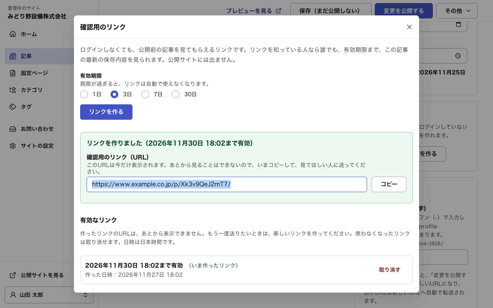
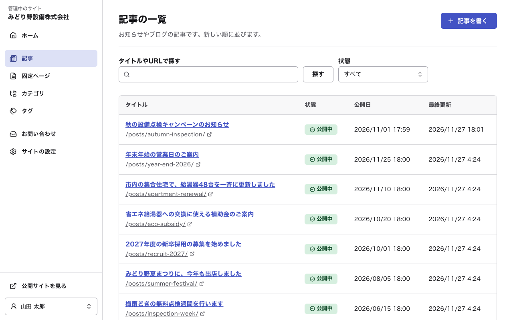
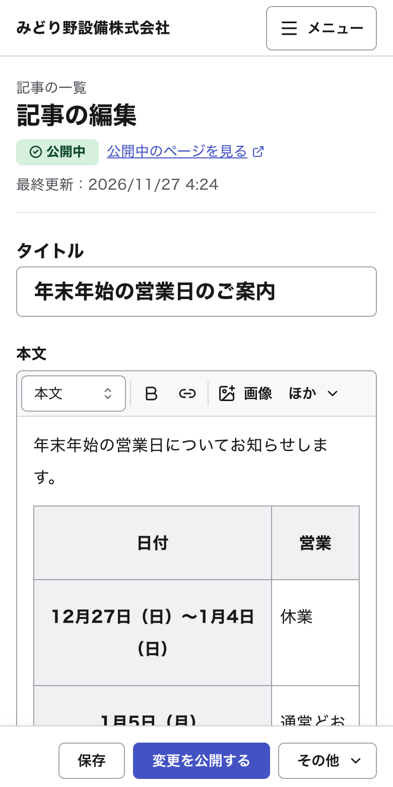

# 記事を書く・公開する

お知らせやブログなどの記事を書いて、公開サイトに出すまでの手順です。
固定ページも、書き方と公開のしかたは同じです。

## 記事を書くには

1. メニューの「記事」を押し、「記事を書く」を押します（ホームの「記事を書く」でも同じです）。
2. 「記事の編集」の画面が開きます。「タイトル」と「本文」を書きます。
3. 「下書き保存」を押します。

- 「記事を書く」を押した時点で、空の下書きが1つできます。
- 本文の書き方は「[本文の書き方](./editor.md)」を見てください。
- キーボードの **Ctrl＋S**（Mac は **⌘＋S**）でも保存できます。
- 保存していない変更があると、ボタンの左に「保存していない変更があります」と出ます。そのままほかの画面へ移ろうとすると、確認が出ます。

下書きは、公開サイトには出ません。何度でも保存し直せます。

## 公開するには

「公開する」を押します。
「公開しました。」と出たら、公開サイトに出ます（反映まで少し時間がかかることがあります）。

- 公開するには、タイトルが必要です。
- 保存していない変更があれば、保存してから公開します。

## 公開したあとで直すには

公開中の記事を開くと、ボタンの名前が変わります。

| 公開する前 | 公開したあと |
| --- | --- |
| 「下書き保存」 | 「保存（まだ公開しない）」 |
| 「公開する」 | 「変更を公開する」 |

- **「保存（まだ公開しない）」**：直した内容を保存するだけです。公開サイトは変わりません。状態に「未公開の変更あり」と付きます。
- **「変更を公開する」**：直した内容を公開サイトに出します。

公開中の記事では、タイトルと本文だけでなく、**公開日・URL・カテゴリとタグも、「変更を公開する」を押すまで公開サイトには出ません。**

### 公開日を変える

公開中の記事では、「公開」の枠に「公開日（日本時間）」の欄が出ます。サイトに表示される日付です。

- 今より前の日時にだけ変えられます。
- 先の日時に変更を出したいときは、次の「日時を決めて公開する」（変更の公開を予約する）を使います。

## 日時を決めて公開するには（予約）

決めた日時に、自動で公開できます。

1. 右の「公開」の枠の「日時を決めて公開する」を押します（「その他」の中にもあります）。
2. 「日付」と「時刻」を選びます。欄の下に「○年○月○日 ○:○○ に公開します」と出るので、確かめます。
3. 「この日時で予約する」を押します。

- 日時は日本時間です。今から1分以上あとの日時にします。はじめは「明日の9:00」が入っています。
- 予約すると、状態が「予約」になり、「公開」の枠に「予約：○年○月○日 ○:○○ に公開」と出ます。
- やめるときは、「予約を取り消す」を押します。
- 予約したあとで「公開する」を押すと、すぐに公開され、予約は取り消されます。

**予約したあとに保存した変更は、予約に含まれません。** 予約のあとで直したときは、「予約し直す」を押して、もう一度予約してください。

### 公開中の記事の変更を予約する

公開中の記事を直して保存すると、「公開」の枠に「変更の公開を予約する」が出ます。
使い方は同じです。予約すると、状態に「更新を予約」と付きます。

## プレビューを見るには

公開する前に、公開サイトでどう見えるかを確かめられます。

1. 上の「プレビューを見る」を押します。
2. 新しいタブで、公開サイトと同じ見た目のページが開きます。

- 保存していない変更があれば、先に保存します（下書きとして保存するだけで、公開はしません）。
- このページは、ログインしている人しか見られません。ログインしていない人に見せたいときは、次の「確認用のリンク」を使います。
- スマートフォンでは「その他」の中にあります。

## ほかの人に見せるには（確認用のリンク）

上司やお客さまなど、管理画面にログインしない人に、公開する前の記事を見てもらうリンクを作れます。

1. 右の「ほかの人に見せる」の枠の「確認用のリンクを作る」を押します。
2. 「有効期間」を選びます（1日・3日・7日・30日）。
3. 「リンクを作る」を押します。
4. 「確認用のリンク（URL）」が出たら、「コピー」を押して、メールやチャットで送ります。

- **URL は、作ったときに一度だけ表示されます。** あとから見ることはできません。もう一度送りたいときは、新しいリンクを作ってください。
- リンクを知っている人なら誰でも、有効期限まで、その記事の **最新の保存内容** を見られます。公開サイトには出ません。
- 保存していない変更があると、ボタンが「保存してリンクを作る」になります。下書きとして保存してから、リンクを作ります。
- 使わなくなったリンクは、「有効なリンク」の一覧で「取り消す」を押すと、すぐに見られなくなります。

## 記事の状態

一覧や編集画面には、記事の状態が出ます。

| 状態 | 意味 |
| --- | --- |
| 下書き | まだ公開していない |
| 予約 | 公開する日時を決めてある |
| 公開中 | 公開サイトに出ている |
| 未公開の変更あり | 公開中だが、直した内容がまだ公開サイトに出ていない |
| 更新を予約 | 公開中で、変更を公開する日時を決めてある |

## 公開をやめる・削除するには

「その他」を押すと、次の操作があります。

- **「公開をやめる」**：公開サイトから見えなくします。内容は下書きとして残ります。変更の予約があれば、それも取り消されます。
- **「削除する」**：記事を削除します。元に戻せません。

## URL を決めるには

記事の URL は、右の「URL」の枠の「ページのURL（英数字）」で決めます。

- 英小文字・数字・ハイフン（-）で入れます。例：`year-end-2026`
- 空のままなら、番号で決まります（例：`/posts/12/`）。
- 欄の下に、実際の URL が出ます。
- 公開中に URL を変えると、「変更を公開する」を押したときに新しい URL になります。古い URL は、新しい URL へ自動で転送されます。

カテゴリとタグは「[カテゴリとタグ](./taxonomy.md)」を見てください。

## 記事を探すには

「記事の一覧」の上で探せます。

- **「タイトルやURLで探す」**：言葉を入れて「探す」を押します。
- **「状態」**：「下書き」「予約」「公開中」「未公開の変更あり」で絞り込みます。
- 「条件をクリア」で元に戻ります。

記事が多いときは、一覧のいちばん下の「もっと見る」で、古い記事を読み込みます。

## スマートフォンで書く

スマートフォンでは、「保存」「公開する」（公開中なら「変更を公開する」）「その他」のボタンが、画面の下に並びます。

{width=320}

- 「プレビューを見る」は「その他」の中にあります。
- 公開日・URL・カテゴリなどの設定は、本文の下にあります。「その他」の「公開日・URL・カテゴリなどの設定へ移動」でも移れます。
