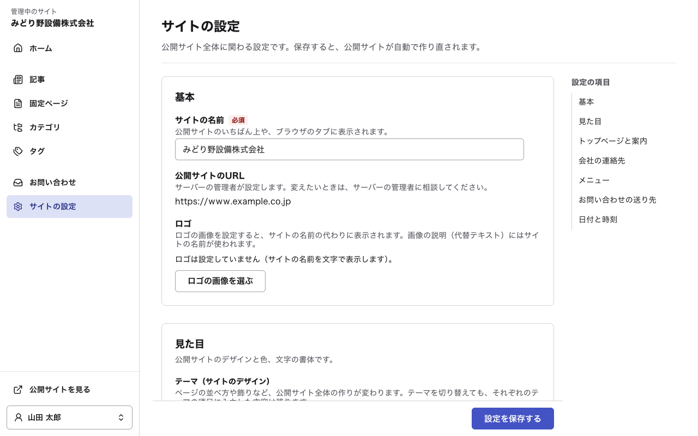
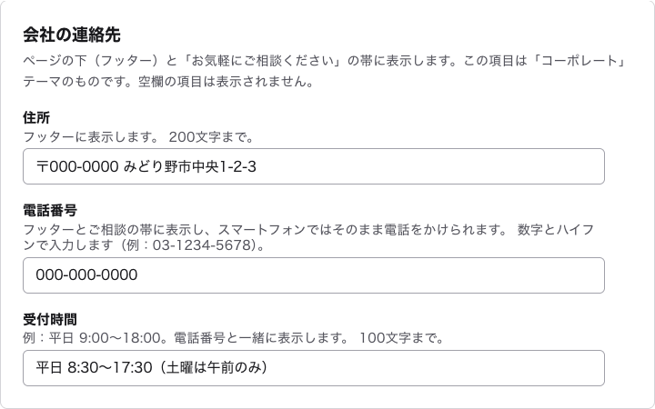
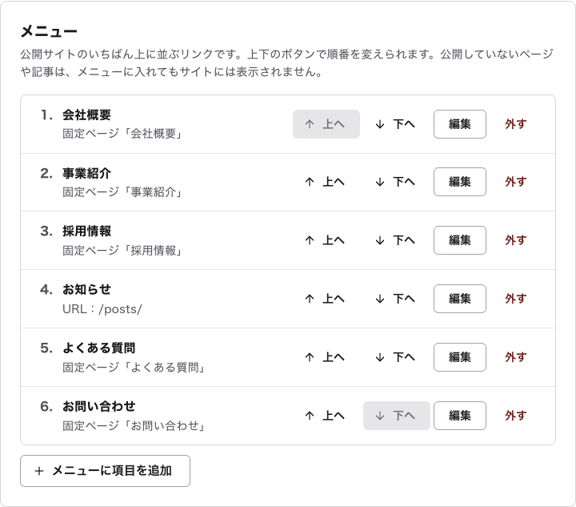

# サイトの設定

サイトの名前やロゴ、色、メニューなど、公開サイト全体に関わる設定です。
**管理者だけ** が使えます。編集者には、メニューに「サイトの設定」が出ません。

## 設定を変えるには

1. メニューの「サイトの設定」を押します。
2. 変えたい項目を直します。右の「設定の項目」を押すと、その場所へ移れます。
3. 画面の下の「設定を保存する」を押します。

- 保存すると、公開サイトが自動で作り直されます。反映まで少し時間がかかることがあります。
- 「設定を保存する」は画面に1つだけです。すべての項目をまとめて保存します。
- 保存していない変更があると、ボタンの左に「保存していない変更があります」と出ます。

## 基本

| 項目 | 内容 |
| --- | --- |
| サイトの名前 | 公開サイトのいちばん上や、ブラウザのタブに出ます。100文字まで |
| 公開サイトのURL | 公開サイトのアドレスです。ここでは変えられません |
| ロゴ | 設定すると、公開サイトでサイトの名前の代わりに出ます |

### 公開サイトのURL

公開サイトのアドレス（例：`https://www.example.co.jp`）は、サーバーの担当者が決めます。管理画面では変えられません。
変えたいときは、サーバーの担当者に相談してください。

### ロゴを設定するには

1. 「ロゴの画像を選ぶ」（設定済みなら「ロゴの画像を変える」）を押します。
2. 新しい画像なら「アップロードしてロゴにする」、アップロード済みの画像なら、画像を押して「この画像をロゴにする」を押します。
3. 「設定を保存する」を押します。

ロゴの画像の説明（代替テキスト）には、サイトの名前が使われます。
ロゴをやめるときは「ロゴを外す」を押して、保存します。

## 見た目

| 項目 | 内容 |
| --- | --- |
| テーマ（サイトのデザイン） | ページの並べ方や飾りなど、公開サイト全体の作りです |
| テーマカラー | リンクやボタン、見出しの飾りの色です |
| フッターの色 | ページのいちばん下（フッター）の背景色です |
| 文字の書体 | 「ゴシック体（標準）」か「明朝体」 |

- テーマを切り替えても、それぞれのテーマの項目に入れた内容は残ります。
- テーマカラーとフッターの色には、白い文字が乗ります。色を選ぶと、「この色の上の白い文字は、はっきり読めます。」か「白い文字が読みにくい色です。もう少し濃い色にしてください。」と出ます。明るすぎる色は保存できません。濃い色を選んでください。

## トップページと案内

| 項目 | 内容 |
| --- | --- |
| トップに載せる固定ページ | 選んだページのタイトルと本文を、トップページのいちばん上に載せます。見せ方はテーマによって違います。選んだページ自身のURLは、トップページへ移るだけになります |
| 個人情報の取り扱いのページ | お問い合わせフォームの「同意する」の欄から、このページにリンクします |

お問い合わせフォームを使うときは、「個人情報の取り扱いのページ」を必ず選んでください。
個人情報の取り扱いの文例は、Pagewright には入っていません。会社で決めている内容を、固定ページに書いて公開してから選びます。

トップページには、このほか、新しい記事が5件（日付・カテゴリ・タイトル）と、いちばん上の階層の固定ページの案内が並びます（標準のテーマ「コーポレート」の場合。お問い合わせフォームのあるページと、個人情報の取り扱いのページは、案内に出ません）。

ページの欄では、タイトルの一部を入れると探せます。

## テーマの項目

使っているテーマによって、ここの見出しと項目が変わります。たとえば「コーポレート」テーマでは「会社の連絡先」として、住所・電話番号・受付時間を入れます。

空欄の項目は、公開サイトに出ません。

## メニュー

公開サイトのいちばん上に並ぶリンクです。

### メニューに項目を足すには

1. 「メニューに項目を追加」を押します。
2. 「リンク先」を選びます。
   - **「このサイトのページや記事」**：「ページや記事」の欄にタイトルの一部を入れて、選びます。
   - **「URLを入力する（ほかのサイトなど）」**：「URL」に、ほかのサイトなら `https://` から、このサイトの中なら `/` から入れます。例：記事の一覧なら `/posts/`
3. 「メニューに表示する名前」を入れます。ページや記事を選んだときは、空欄ならタイトルが出ます。
4. 「追加する」を押します。
5. 画面の下の「設定を保存する」を押します。

- 並び順は「上へ」「下へ」で変えます。
- メニューから外すときは「外す」を押します（ページや記事は削除されません）。
- メニューは20項目まで、表示する名前は50文字までです。
- 公開していないページや記事は、メニューに入れても公開サイトには出ません。一覧に「（公開していないため、いまはサイトに出ません）」と出ます。

## お問い合わせの送り先

「お問い合わせの送り先メールアドレス」に入れたアドレスへ、お問い合わせフォームから届いた内容をメールで知らせます。
空欄にすると、このサイトの管理者全員に届きます。

## 日付と時刻

「タイムゾーン」は、公開サイトに表示する日付の基準になる地域です。日本のサイトなら「日本（東京）」のままにしてください。管理画面で予約や公開日の日時を入れるときは、この設定にかかわらず日本時間で入力します。

## 次に読むページ

- [固定ページと親子](./pages.md)
- [お問い合わせ](./inquiries.md)
