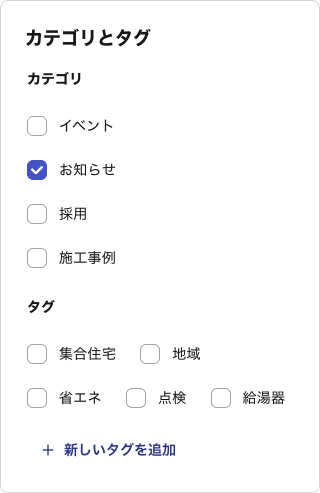
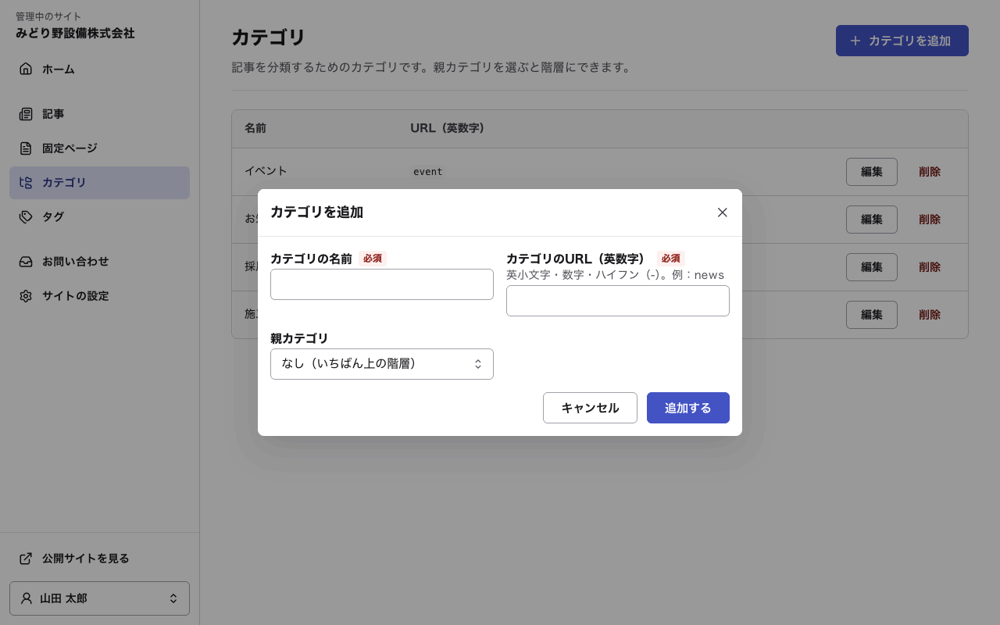
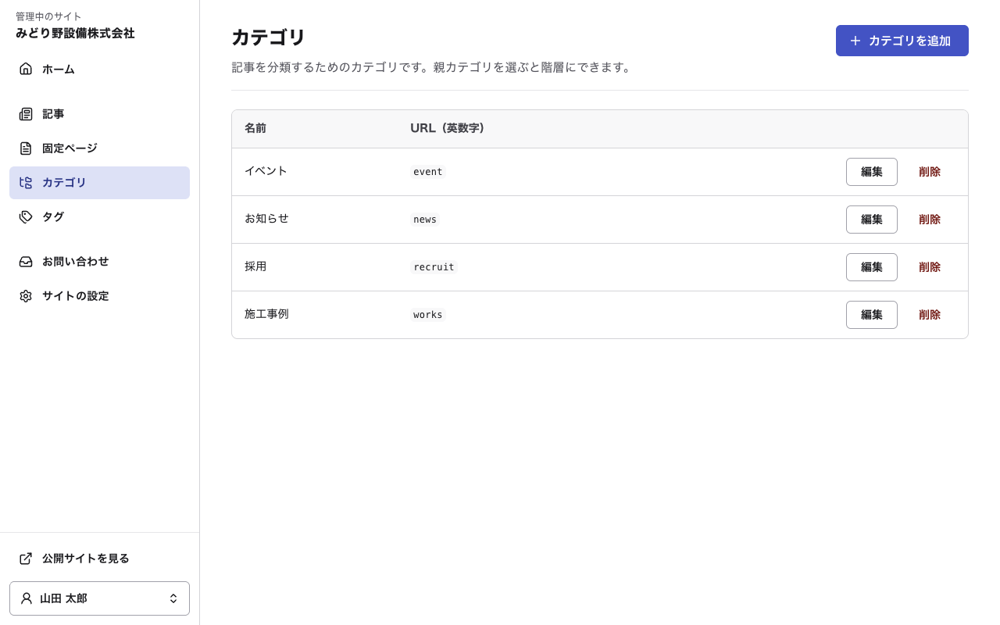
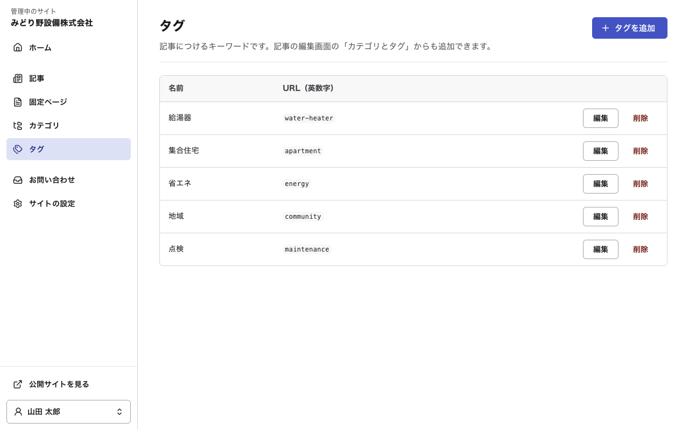

# カテゴリとタグ

記事は「カテゴリ」と「タグ」で分けられます。公開サイトでは、カテゴリやタグごとの記事の一覧ページができます。

| | カテゴリ | タグ |
| --- | --- | --- |
| 向いているもの | 大きな分け方（お知らせ、施工事例、採用など） | 記事の中身を表すキーワード（給湯器、省エネ、地域など） |
| 階層 | 親カテゴリの下に子カテゴリを作れる | 階層なし |
| 公開サイトの URL の例 | `/posts/category/news/` | `/posts/tag/eco/` |

カテゴリとタグは記事だけに使えます。固定ページにはつけられません。

## 記事にカテゴリとタグをつけるには

記事の編集画面の右（スマートフォンでは本文の下）の「カテゴリとタグ」の枠で、チェックをつけます。

- 1つの記事に、いくつでもつけられます。
- 保存すると記録されます。公開中の記事では、「変更を公開する」を押すまで公開サイトには出ません。
- タグが10個より多いと、「タグを絞り込む」の欄が出ます。名前の一部を入れると、合うタグだけが並びます。

### その場で新しいタグを作る

1. 「新しいタグを追加」を押します。
2. 「タグの名前」と「タグのURL（英数字）」を入れます。
3. 「タグを追加して選ぶ」を押します。作ったタグに、チェックがついた状態になります。

## カテゴリを作るには

1. メニューの「カテゴリ」を押します。
2. 「カテゴリを追加」を押します。
3. 「カテゴリの名前」「カテゴリのURL（英数字）」を入れます。子カテゴリにするときは「親カテゴリ」を選びます。
4. 「追加する」を押します。

「カテゴリのURL（英数字）」は、英小文字・数字・ハイフン（-）で入れます。例：`news`

## カテゴリを直す・削除するには

「カテゴリ」の画面の一覧で、カテゴリの行の「編集」か「削除」を押します。

カテゴリを削除しても、記事は削除されません。記事は、そのカテゴリから外れるだけです。
子カテゴリがあるときは、子カテゴリは削除されず、一つ上の階層に移ります。

## タグを作る・直す・削除するには

メニューの「タグ」を押します。使い方は、カテゴリと同じです（タグには親はありません）。

- タグの「URL（英数字）」を変えると、古い URL は新しい URL へ自動で転送されます。
- タグを削除しても、記事は削除されません。記事から、そのタグが外れるだけです。

## 次に読むページ

- [画像](./images.md)
- [サイトの設定](./settings.md)：メニューにカテゴリの一覧を入れる
