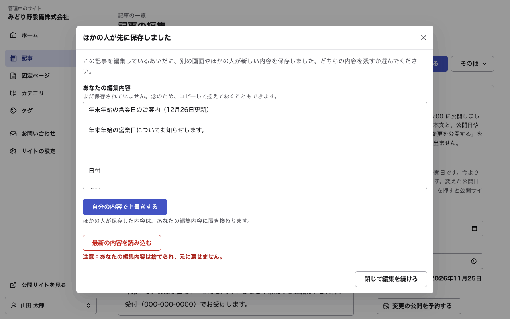

# 困ったとき

よくある困りごとと、その対処です。
ここで解決しないときは、サイトを作った会社や担当者に連絡してください。

## ログイン

### ログインのメールが届かない

1. 迷惑メールのフォルダを確かめてください。件名は「Pagewright ログイン用のリンク」です。
2. メールアドレスのまちがいがないか確かめて、「別のメールアドレスで送り直す」から送り直してください。
3. 会社のメールで届かないときは、メールの受け取りを制限していないか、社内の担当者に確かめてください。

登録していないメールアドレスを入れても、「メールを送りました」と出ます（誰が登録しているかを、ほかの人に知られないためです）。その場合、メールは届きません。
自分のアドレスが登録されているか分からないときは、サイトの管理者に確かめてください。

短いあいだに何度も送ると、しばらく送られなくなることがあります。時間をおいてから試してください。

### 「ログイン用のリンクが無効か、有効期限が切れています」と出る

ログイン用のリンクは、**15分** で切れ、**1回だけ** 使えます。
「ログイン用のリンクを送り直す」を押して、新しいリンクを送ってください。何度か送ったときは、いちばん新しいメールのリンクを使ってください。

### 「管理できるサイトがありません」と出る

そのメールアドレスは登録されていますが、どのサイトにも入っていません。サイトの管理者に連絡してください。

### いつの間にかログアウトしていた

ログインは、ログインした日から30日で切れます。また、「ログイン中の端末」でほかの人（または自分）がログアウトさせたときも切れます。
もう一度ログインしてください。

## 書く・保存する

### 「ほかの人が先に保存しました」と出た

同じ記事を、ほかの人（または別のタブやパソコンの自分）が先に保存したときに出ます。どちらの内容を残すかを選びます。

| ボタン | どうなるか |
| --- | --- |
| 自分の内容で上書きする | 自分の内容で保存します。ほかの人が保存した内容は、自分の内容に置き換わります |
| 最新の内容を読み込む | ほかの人が保存した内容を読み込みます。**自分の編集内容は捨てられ、元に戻せません** |
| 閉じて編集を続ける | どちらも選ばずに、編集に戻ります。まだ保存されていません |

迷ったら、まず「あなたの編集内容」の欄の文をコピーして、メモ帳などに控えておきましょう。
そのあと「最新の内容を読み込む」を押して、必要なところだけ貼り直すと安全です。

同じ記事を何人かで直すときは、「いま直しています」と声をかけあうと、このダイアログが出にくくなります。

### 保存したのに公開サイトが変わらない

公開中の記事は、「保存（まだ公開しない）」では公開サイトが変わりません。「変更を公開する」を押してください。
状態に「未公開の変更あり」と出ていたら、まだ公開していない変更があります。

「変更を公開する」を押しても変わらないときは、「[サイトを更新する](./site-update.md)」を見てください。

### 予約したのに、直した内容が出なかった

予約したあとに保存した変更は、予約に含まれません。「公開」の枠に「予約したあとに保存した変更は、この予約に含まれていません。」と出ていたら、「予約し直す」を押して、もう一度予約してください。

### 「公開する」を押したらタイトルの欄が赤くなった

公開や予約には、タイトルが必要です。タイトルを入れてから、もう一度押してください。

### 「このURLはすでに使われています」と出る

ほかの記事やページ、カテゴリ、タグが同じ URL を使っています。「ページのURL（英数字）」（カテゴリやタグなら「URL（英数字）」）を別のものにしてください。

### 「HTMLブロックを追加・変更できるのは管理者だけです」と出る

WordPress などから移行した記事の「カスタムHTML」の枠は、管理者しか変えたり消したりできません。
編集者のときは、その枠に触らずに保存するか、管理者に頼んでください。

### 「（タイトルなし）」の記事が一覧にある

「記事を書く」や「固定ページを作る」を押すと、その時点で空の下書きができます。何も書かずに画面を離れると、「（タイトルなし）」の下書きが残ります。
いらないときは、開いて「その他」の「削除する」で削除してください。

## 画像

### 画像をアップロードできない

- 「10MBまでの画像を選んでください。」：画像が大きすぎます。写真アプリなどで小さくしてください。
- 「使える画像の形式は JPEG・PNG・GIF・WebP です。」：パソコンに取り込んだ iPhone の写真（HEIC 形式）などは、そのままでは使えません。JPEG に変えてからアップロードしてください。
- 「画像を保存できる容量（○MB）がいっぱいのため…」：「[画像の容量の上限](./images.md#画像の容量の上限)」を見てください。

### 画像を削除できない

記事や固定ページ（公開中の内容や予約した内容を含む）、またはロゴで使っている画像は削除できません。くわしくは「[画像を削除するには](./images.md#画像を削除するには)」。

## そのほか

### メニューに「お問い合わせ」「サイトの設定」がない

この2つは管理者だけが使えます。変更が必要なときは、サイトの管理者に頼んでください。

### お問い合わせのメールが届かない

「サイトの設定」の「お問い合わせの送り先メールアドレス」を確かめてください（管理者だけ）。迷惑メールのフォルダも確かめてください。
メールが届かなくても、届いたお問い合わせは管理画面の「お問い合わせ」で見られます。

### 確認用のリンクを、送った相手が開けない

- リンクの有効期限が切れていないか、「確認用のリンク」の「有効なリンク」で確かめてください。期限が切れたリンクは一覧から消えます。
- 取り消したリンクは使えません。新しいリンクを作って送り直してください。
