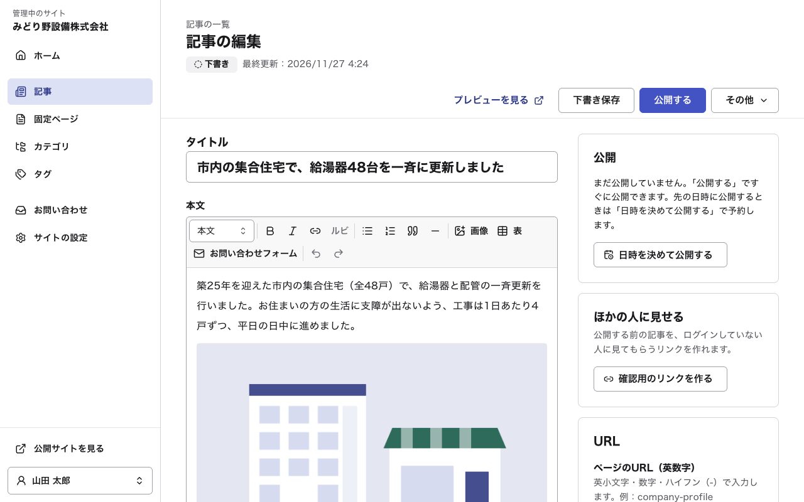

## Pagewright とは

会社のお知らせや会社概要のページを、管理画面から書いて公開できるしくみです。

- **表示が速い**：公開サイトは、前もって作っておいたページのファイルを配るだけなので、すぐに開きます
- **管理画面が止まってもサイトは見える**：管理画面と公開サイトは別々に動きます。管理画面のメンテナンス中も、公開サイトは表示され続けます
- **日本語に強い**：日本語のサイト内検索、ルビ（ふりがな）に対応しています
- **パスワードがいらない**：ログインはメールで届くリンクで行います
- **WordPress から移れる**：WordPress の記事・固定ページ・カテゴリ・タグ・画像を取り込めます

## いまの状態

最初の版（v0.1.0）を出す前の、試用向けの段階です。

| できること | まだないもの |
| --- | --- |
| 記事と固定ページを書く・公開する（予約公開、公開前の確認用リンクつき） | パスキーでのログイン |
| カテゴリとタグ、固定ページの親子 | プラグイン |
| 画像（説明文つき）、表、ルビ、お問い合わせフォーム（通知と自動返信のメールつき） | 縦書き、和暦 |
| 日本語のサイト内検索、サイトマップ、RSS | 画像だけをまとめて管理する画面 |
| WordPress からの移行（古い URL からの転送つき） | 管理画面から YouTube や地図を埋め込むこと |
| 1台のサーバーで複数のサイト、バックアップと復元 | 保存した古い内容に、画面から戻すこと |

標準のテーマ（見た目）は、会社サイト向けの「コーポレート」1つです。

次のようなサイトには向いていません：ネットショップ（EC）、会員制のサイト、コメント欄が必要なブログ。

## ライセンス

本体は AGPL-3.0、テーマとプラグインのSDKは MIT（予定）です。

自社のサイトを Pagewright で動かすだけなら、書いた記事や画像を公開する必要はありません。
Pagewright 自体を改造して、ネットワークを通してほかの人に使わせるときは、その人たちが改造後のソースコードを入手できるようにする必要があります。
これは目安で、法律の助言ではありません。くわしくは [ライセンスの本文](https://github.com/kom3da/pagewright/blob/main/LICENSE) を確かめてください。
